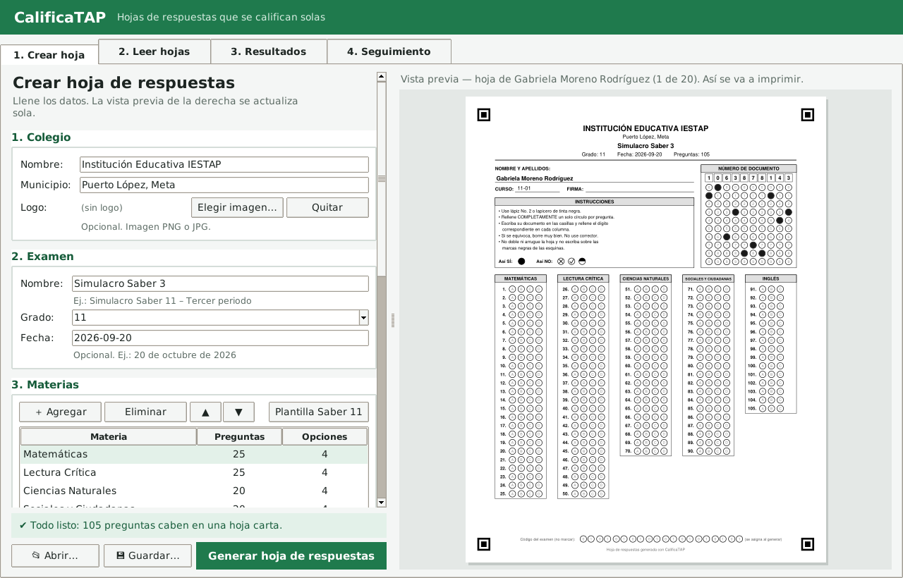
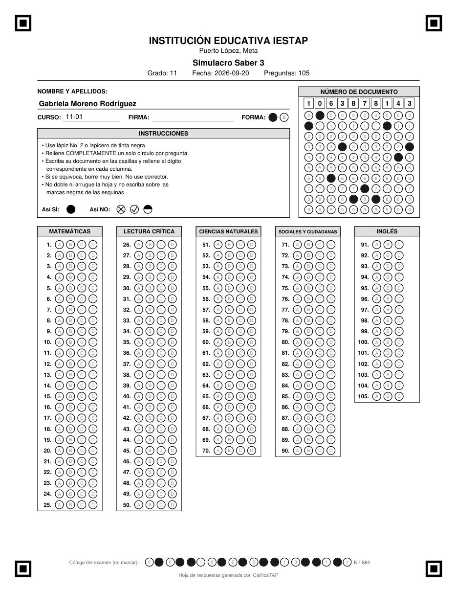
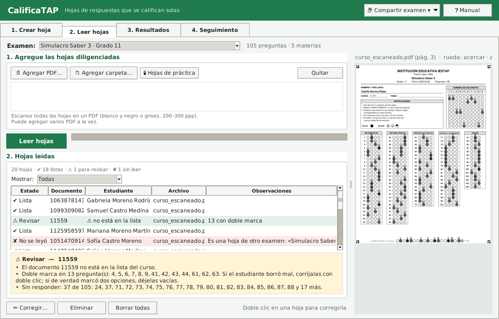
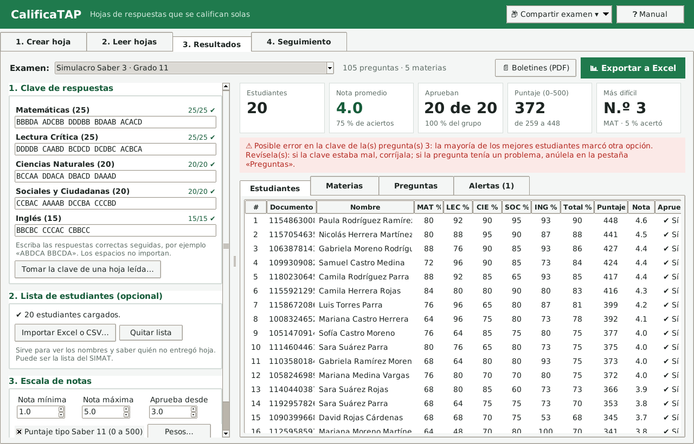
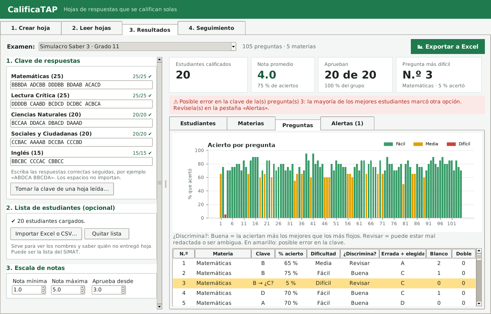
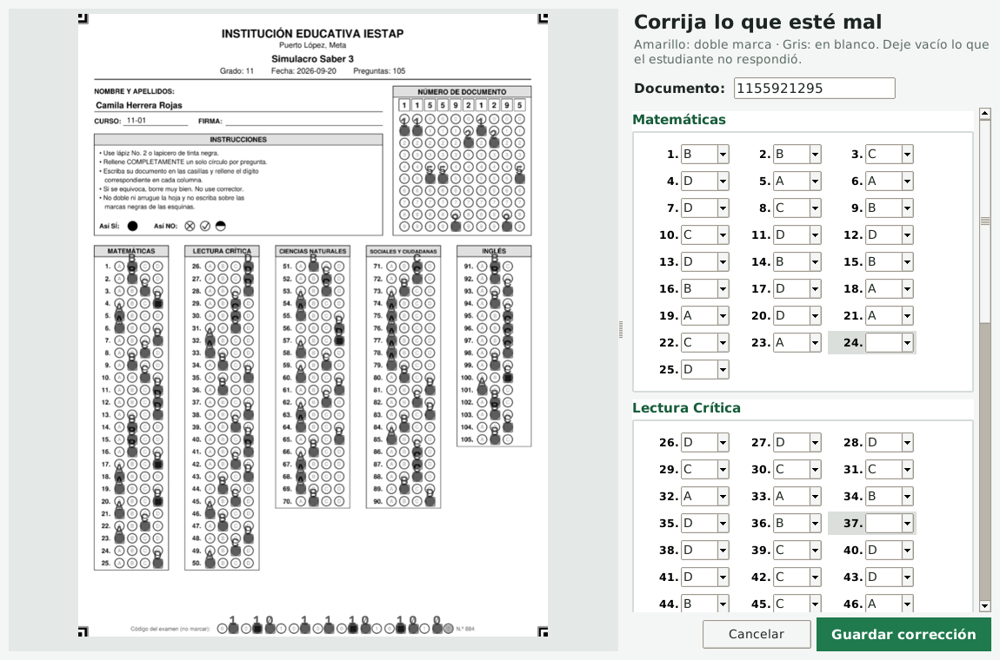
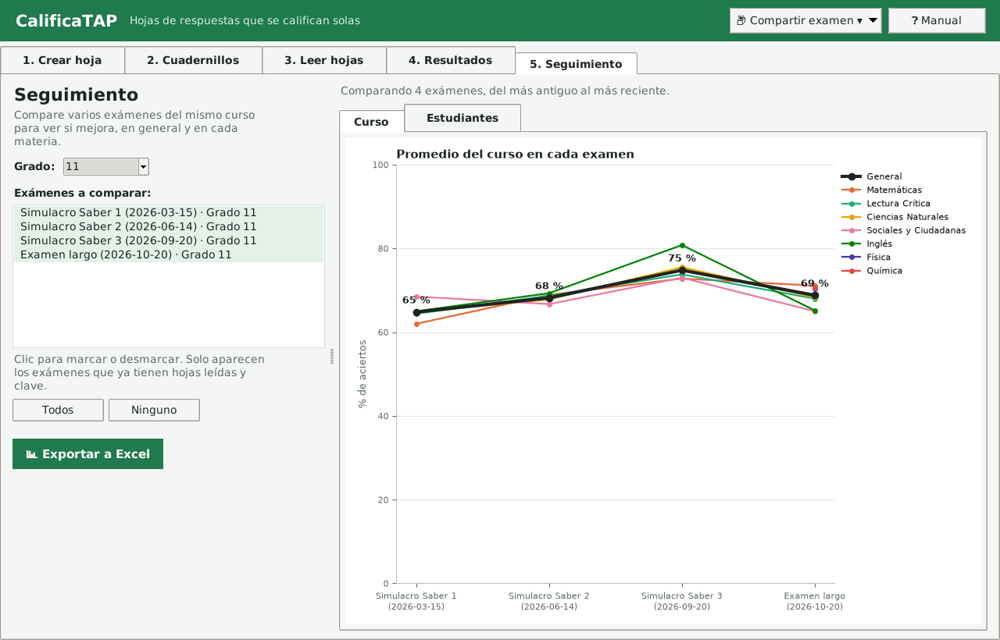

<div align="center">

# CalificaTAP

**Hojas de respuestas que se califican solas.**

Sistema de calificación automática de exámenes de selección múltiple (OMR) para colegios,
pensado para funcionar **sin internet** en la escuela rural.


</div>

CalificaTAP crea hojas de respuestas a la medida de cada examen, las **lee** desde el PDF del
escáner, y entrega las **notas**, los resultados por estudiante,
materia y pregunta, boletines individuales y un archivo de Excel.

Lo creó un docente de la **IESTAP** (Institución Educativa Santa Teresa de Pachaquiaro,
Puerto López, Meta, Colombia) para resolver una necesidad real del
colegio: calificar simulacros tipo Saber 11 sin pasar horas revisando hojas a mano.

<p align="center">
  
</p>

---

## Contenido

- [¿Qué hace?](#qué-hace)
- [Capturas](#capturas)
- [Instalación para docentes (Windows)](#instalación-para-docentes-windows)
- [Cómo se usa](#cómo-se-usa)
- [Instalación para desarrolladores](#instalación-para-desarrolladores)
- [Cómo funciona por dentro](#cómo-funciona-por-dentro)
- [Estructura del proyecto](#estructura-del-proyecto)
- [Pruebas](#pruebas)
- [Hoja de ruta](#hoja-de-ruta)
- [Créditos y licencia](#créditos-y-licencia)

---

## ¿Qué hace?

| Módulo | Qué hace |
|---|---|
| **1 · Crear hoja** | Diseña la hoja: colegio, logo, materias, número de preguntas y opciones (A–D, A–E…). Vista previa en vivo. Genera el PDF para imprimir y la plantilla de lectura, **siempre sincronizados**. |
| **2 · Cuadernillos** | Las preguntas se escriben una vez en el **editor de preguntas** del programa (con vista previa, imágenes con Ctrl+V y fórmulas), se traen de un **Word** o se llenan en Excel y el programa arma un **cuadernillo por forma** en PDF, estilo pruebas Saber (dos columnas, «RESPONDA LAS PREGUNTAS… DE ACUERDO CON LA SIGUIENTE INFORMACIÓN»), cambiando el orden de preguntas y/u opciones. La clave de cada forma queda lista. |
| **3 · Leer hojas** | Lee los PDF del escáner (con [OMRChecker](https://github.com/Udayraj123/OMRChecker)). Muestra lo que detectó en cada hoja y permite corregir a mano. |
| **4 · Resultados** | Clave de respuestas, notas en la escala que se elija (por defecto 1,0–5,0), puntaje tipo Saber 11 (0–500), tablero con gráficos, análisis por pregunta, anulación de preguntas, alertas, Excel y boletines en PDF. |
| **5 · Seguimiento** | Compara varios exámenes (por ejemplo, los simulacros del año) para ver si el curso y cada estudiante mejoran. |

Además:

- **Hojas con nombre:** se importa la lista del curso (Excel o CSV, por ejemplo la del SIMAT) y
  se imprime una hoja por estudiante con su nombre y su documento **ya marcados**.
- **Dos versiones de hoja:** con el **número de documento** (cuadrícula completa) o con el
  **N.º de lista** (dos cifras, encabezado compacto e instrucciones en un renglón): en una sola
  hoja caben unas **190 preguntas en vez de 140**. El estudiante se reconoce por su posición en
  la lista del curso.
- **Formas A/B/C/D (opcional):** una clave por forma. Si los cuadernillos los arma el programa,
  la clave de cada forma se calcula sola y en «Resultados» se pueden ver **las formas juntas**
  (cada pregunta una vez, con todos los estudiantes).
- **Código del examen:** cada examen imprime un código en la franja inferior; si se cuela una hoja
  de otro examen, el lector la detecta.
- **Exámenes de varias hojas:** si las preguntas no caben, se reparten solas en 2, 3 o 4 hojas que
  se pueden escanear en cualquier orden.
- **Revisión de la clave:** avisa cuando una pregunta probablemente tiene la clave errada
  (casi nadie acierta y los mejores estudiantes marcan la misma otra opción).
- **Calidad de las preguntas:** índice de discriminación (27 % superior e inferior, Kelley).
- **Puntaje tipo Saber 11 (0–500):** promedio ponderado × 5 como el ICFES (Lectura, Matemáticas,
  Sociales y Ciencias pesan 3; Inglés 1; pesos editables). Se activa solo en los simulacros.
  Es una aproximación: cada materia vale su % de aciertos (el ICFES usa el modelo Rasch).
- **Revisión rápida:** recorre una por una las preguntas con doble marca, las formas sin marcar y
  los documentos incompletos o fuera de la lista, mostrando esa parte de la imagen ampliada.
  Se responde con el teclado (A, B, C… o espacio = en blanco) y cada cambio se guarda enseguida.
- **Opciones por partes:** dentro de una materia, unas preguntas pueden tener A–H y otras A–C o
  A–D (como Inglés del ICFES). La hoja de respuestas muestra en cada pregunta solo sus opciones y,
  si hace falta, deja más anchas solo las últimas columnas para no gastar otra hoja.
- **Opciones con imagen** en los cuadernillos («¿Cuál gráfica representa…?»), en dos columnas.
- **Biblioteca de preguntas del colegio:** guarda preguntas (con tema y grado) para reutilizarlas en
  otros exámenes; se buscan por materia, tema o texto y se traen con un clic.
- **Anular preguntas:** una pregunta mal redactada o con dos respuestas válidas se puede dar por
  buena a todos o sacar del cálculo; las notas se recalculan solas y se puede deshacer.
- **Boletines individuales** en PDF, una página por estudiante.
- **Informe para coordinación** (PDF de 2 páginas): niveles de desempeño (Superior, Alto, Básico,
  Bajo), distribución de notas, resultados por materia, comparación entre cursos, las 10 preguntas
  más difíciles con la opción errada más elegida, preguntas para revisar y espacio para firmas.
- **Compartir examen:** exporta o importa un examen completo en un `.zip` (otro docente, otra sede, copia de seguridad).
- **Hojas de práctica:** genera un curso inventado ya diligenciado para aprender a usar el programa sin imprimir nada.
- **Manual para docentes** en PDF ([`Manual CalificaTAP.pdf`](Manual%20CalificaTAP.pdf)).

## Capturas

| Hoja con nombre | Leer hojas |
|---|---|
|  |  |

| Resultados | Análisis por pregunta |
|---|---|
|  |  |

| Corrección manual | Seguimiento entre exámenes |
|---|---|
|  |  |

> Los nombres y documentos de las capturas son inventados (hojas de práctica).

## Instalación para docentes (Windows)

Se hace **una sola vez, con internet**. Después el programa funciona sin conexión.

1. Instale **Python 3.10 o superior** desde [python.org](https://www.python.org/downloads/).
   Durante la instalación marque la casilla **«Add python.exe to PATH»**.
2. Descargue este repositorio: botón verde **Code → Download ZIP** y descomprímalo
   (por ejemplo en `Documentos\CALIFICATAP`).
3. Descargue OMRChecker y póngalo dentro de la carpeta `externo`, de modo que quede
   `externo\OMRChecker\main.py`
   ([descargar ZIP](https://github.com/Udayraj123/OMRChecker/archive/refs/heads/master.zip)
   y renombrar la carpeta `OMRChecker-master` a `OMRChecker`).
4. Doble clic en **`Instalar.bat`** y espere a que diga «Listo».
5. Para abrir el programa, cada vez: doble clic en **`Abrir CalificaTAP.bat`**.

## Cómo se usa

1. **Crear hoja:** llene los datos del colegio y del examen, agregue las materias (o use
   «Plantilla Saber 11») y pulse **Generar hoja de respuestas**.
   Imprima en **«Tamaño real» / 100 %**, nunca «Ajustar a la página».
   *Opcional:* en **Cuadernillos**, pulse **✏ Escribir las preguntas** (o tráigalas de un Word)
   y luego **Generar cuadernillos** (un PDF por forma; la clave queda lista).
2. **Día del examen:** lápiz No. 2 o lapicero negro, rellenando completamente un solo círculo.
3. **Leer hojas:** escanee todas las hojas en un solo PDF (blanco y negro o grises,
   200–300 ppp), agréguelo y pulse **Leer hojas**. Verde = bien, amarillo = revisar, rojo = no se leyó.
   Debajo de la lista, el recuadro de observaciones dice qué preguntas tienen doble marca o
   quedaron en blanco. Con **⚡ Revisión rápida** se resuelven una por una, ampliadas.
   Doble clic sobre una hoja para corregirla completa.
4. **Resultados:** escriba la clave (una línea por materia) o tómela de una hoja leída, importe
   la lista del curso y revise notas, gráficos y alertas. Exporte a Excel, genere los boletines o el informe para coordinación.

Todo lo que produce el programa queda en `salidas/<nombre_del_examen>/`.
El paso a paso con imágenes está en el [manual](Manual%20CalificaTAP.pdf).

## Instalación para desarrolladores

```bash
git clone https://github.com/<usuario>/CalificaTAP.git
cd CalificaTAP
python -m pip install -r requirements.txt

# Motor de lectura OMR (se usa como programa externo, no se modifica)
git clone https://github.com/Udayraj123/OMRChecker externo/OMRChecker
python -m pip install -r externo/OMRChecker/requirements.txt

python CalificaTAP.pyw                                   # interfaz gráfica
python generar_hoja.py configuracion/examen_ejemplo.json # Módulo 1 desde la consola
```

Probado con OMRChecker en el commit `5cf44a5`. Si una versión más nueva cambia el formato de
`template.json`, se puede volver a ese commit con `git -C externo/OMRChecker checkout 5cf44a5`.

**Dependencias principales:** reportlab (PDF), OpenCV y NumPy (imágenes), PyMuPDF (PDF → imagen),
Pillow, pandas y openpyxl (reportes y Excel), matplotlib (gráficos), tkinter (interfaz, viene con Python).

## Cómo funciona por dentro

### El PDF y la plantilla siempre coinciden

Es el problema central de cualquier sistema OMR: si la hoja impresa y la plantilla de lectura
no coinciden al milímetro, las respuestas se leen mal. CalificaTAP lo resuelve así:

1. **Una sola fuente de verdad.** `maquetador.py` calcula todas las posiciones y las guarda en
   una `Maqueta`. El PDF (`dibujante_pdf.py`) y la plantilla (`plantilla_omr.py`) se generan
   *leyendo* esa maqueta; ninguno calcula posiciones por su cuenta.
2. **Las burbujas siguen la regla de OMRChecker.** Cada grupo de preguntas es un `BloqueCampos`
   (origen + paso entre opciones + paso entre preguntas), lo mismo que un `fieldBlock` de OMRChecker.
3. **Una sola conversión de coordenadas.** OMRChecker endereza la imagen con los *centros* de las
   4 marcas de las esquinas; para él, (0, 0) es el centro de la marca superior izquierda.
   La plantilla resta ese punto y multiplica por 2 px/pt.
4. **Comprobación automática.** `verificar.py` convierte el PDF en imagen y mide la distancia
   entre cada círculo impreso y su cuadro en la plantilla (debe ser menor a 1 px).

### Lectura

- **Solo PDF del escáner.** Cada página se convierte en imagen (200 ppp) y OMRChecker la endereza
  con las 4 marcas (`CropOnMarkers`). Hubo una versión que también leía fotos de celular, pero
  en las pruebas con hojas reales los PDF se leyeron perfecto y las fotos no, así que se retiró.
- OMRChecker se ejecuta como proceso aparte; la interfaz muestra el avance sin congelarse.
- En exámenes de varias hojas hay una primera pasada que solo lee el código del examen, el número
  de hoja y el documento; luego cada imagen se lee con la plantilla de su hoja.
- Las lecturas se guardan en `lecturas/respuestas.csv`. Si se vuelve a leer la hoja de un
  estudiante, la nueva reemplaza a la anterior.

### Calificación

- `calificar.py` cruza lecturas, clave(s) y lista del curso con pandas: resultados por estudiante,
  materia y pregunta, alertas (documento repetido, falta una hoja, no está en la lista, sin forma…).
- **Posible error en la clave:** acierto < 35 %, y entre el tercio de mejores estudiantes
  (mínimo 5) al menos la mitad marcó la misma otra opción. Solo con 10 o más estudiantes por forma.
- **Preguntas anuladas** (`clave.json` → `"anuladas": {"A": {"MAT_05": "bien" | "excluir"}}`):
  «bien» cuenta como acierto para todos; «excluir» deja la pregunta fuera del cálculo. El análisis
  de la pregunta (% de acierto, discriminación) se hace con lo que de verdad marcaron.
- **Puntaje tipo Saber:** `round(5 × Σ peso·% materia / Σ pesos)`; con el puntaje activo, el puesto
  lo da el puntaje.

## Estructura del proyecto

```
CalificaTAP/
├── Instalar.bat                 ← docentes: instalar (una vez)
├── Abrir CalificaTAP.bat        ← docentes: abrir la aplicación
├── CalificaTAP.pyw              ← la aplicación con ventanas (tkinter)
├── generar_hoja.py              ← Módulo 1 desde la consola
├── Manual CalificaTAP.pdf       ← manual para docentes
├── requirements.txt
├── configuracion/               ← JSON de cada examen (examen_ejemplo.json)
├── datos/                       ← listas y claves locales (no se suben a GitHub)
├── escaneos/                    ← PDF escaneados de las hojas (no se suben a GitHub)
├── salidas/                     ← lo que genera el programa, una carpeta por examen (no se sube)
├── biblioteca/                  ← preguntas guardadas para reutilizar (no se sube)
├── externo/OMRChecker/          ← motor de lectura (se descarga aparte)
├── calificatap/
│   ├── examenes.py              ← encuentra los exámenes generados y sus archivos
│   ├── compartir.py             ← exportar / importar un examen en .zip
│   ├── cuadernillos/            ← Módulo 0: banco de preguntas → cuadernillos por forma
│   │   ├── banco.py             ←   plantilla de Excel y lectura (con imágenes pegadas)
│   │   ├── formas.py            ←   baraja preguntas/opciones; formas.json; claves
│   │   ├── pdf.py               ←   dibuja el cuadernillo (reportlab, dos columnas) y la vista previa
│   │   ├── word.py              ←   importa preguntas desde Word (.docx)
│   │   ├── biblioteca.py        ←   biblioteca de preguntas del colegio (biblioteca/)
│   │   ├── formulas.py          ←   fórmula «a lo LaTeX» → imagen (matplotlib, sin internet)
│   │   └── generar.py           ←   une todo
│   ├── generador/               ← Módulo 1
│   │   ├── diseno.py            ←   medidas (burbujas, márgenes, franja del código…)
│   │   ├── configuracion.py     ←   lee y valida el JSON
│   │   ├── maqueta.py           ←   el "plano" de la hoja (clases de datos)
│   │   ├── maquetador.py        ←   calcula dónde va cada cosa (y reparte en varias hojas)
│   │   ├── dibujante_pdf.py     ←   maqueta → PDF (reportlab)
│   │   ├── plantilla_omr.py     ←   maqueta → template.json (OMRChecker)
│   │   ├── verificar.py         ←   comprueba que PDF y plantilla coinciden
│   │   └── generar.py           ←   une todo; código del examen; hojas con nombre
│   ├── lector/                  ← Módulo 2
│   │   ├── omr.py               ←   PDF del escáner → OMRChecker
│   │   ├── hojas.py             ←   lo leído de cada hoja (lecturas/respuestas.csv)
│   │   └── practica.py          ←   inventa un curso para practicar sin imprimir
│   ├── reportes/                ← Módulo 3
│   │   ├── clave.py             ←   clave de respuestas (una por forma)
│   │   ├── estudiantes.py       ←   importa la lista del curso (Excel/CSV)
│   │   ├── calificar.py         ←   notas, materias, preguntas, alertas
│   │   ├── seguimiento.py       ←   compara varios exámenes
│   │   ├── boletines.py         ←   boletín individual en PDF
│   │   ├── informe.py           ←   informe para coordinación (PDF de 2 páginas)
│   │   └── excel.py             ←   resultados.xlsx y seguimiento.xlsx
│   └── interfaz/                ← ventanas (tkinter)
│       ├── app.py               ←   ventana principal y pestañas
│       ├── pestana_generador.py, pestana_cuadernillos.py, pestana_lector.py,
│       │   pestana_resultados.py, pestana_seguimiento.py
│       ├── vista_previa.py      ←   dibuja la hoja en pantalla
│       ├── ventana_importar.py  ←   importar la lista de estudiantes
│       ├── ventana_compartir.py ←   exportar / importar examen
│       ├── ventana_revision.py  ←   revisión rápida de las hojas amarillas
│       ├── editor_preguntas.py  ←   editor de preguntas del cuadernillo
│       ├── ventana_biblioteca.py ←  buscar / guardar preguntas en la biblioteca
│       ├── estilos.py, utilidades.py
├── docs/
│   ├── crear_manual.py          ← arma «Manual CalificaTAP.pdf»
│   └── capturas/                ← imágenes del manual y de este README
└── pruebas/
    ├── prueba_omrchecker.py     ← prueba completa con OMRChecker real
    └── crear_hojas_de_prueba.py ← inventa un curso para practicar
```

## Pruebas

```bash
python pruebas/prueba_omrchecker.py
```

Rellena al azar una hoja generada (con formas y documento), simula un **escaneo** derecho y otro
**torcido** (girado 1–2° y con ruido), ejecuta OMRChecker y compara lo leído con lo marcado. Debe terminar con
`✔ OMRChecker leyó exactamente lo que se marcó`.

Para practicar con la interfaz sin imprimir: pestaña **Leer hojas → 🧪 Hojas de práctica**,
o `python pruebas/crear_hojas_de_prueba.py`.

## Hoja de ruta

- [x] Generador de hojas con vista previa y verificación automática
- [x] Lector de PDF escaneados con corrección manual
- [x] Prueba con hojas impresas: PDF ✔ · fotos de celular ✘ (retiradas)
- [x] Resultados, Excel, seguimiento, boletines
- [x] Hojas con nombre, formas, código del examen, varias hojas
- [x] Biblioteca de preguntas, opciones con imagen y opciones por partes
- [x] Hoja con N.º de lista (más preguntas por hoja)
- [ ] Instalador `.exe` (sin necesidad de instalar Python)
- [x] Cuadernillos por forma (banco en Excel, estilo Saber) con clave automática
- [ ] Pruebas unitarias con pytest

## Privacidad

Las listas de estudiantes, los escaneos y los resultados contienen datos personales de menores
de edad. Por eso `datos/`, `escaneos/` y `salidas/` están en `.gitignore`: **no los suba a GitHub**.
Para pasar un examen a otro computador use **Compartir examen → Exportar**.

## Créditos y licencia

Desarrollado por **Brayan Jiménez Moya**, docente de Tecnología de la
**Institución Educativa Santa Teresa de Pachaquiaro (IESTAP)**, Puerto López, Meta, Colombia.

La lectura de burbujas usa [OMRChecker](https://github.com/Udayraj123/OMRChecker)
de Udayraj Deshmukh y colaboradores (licencia MIT), que se descarga aparte.

Este proyecto se publica bajo la [licencia MIT](LICENSE).
